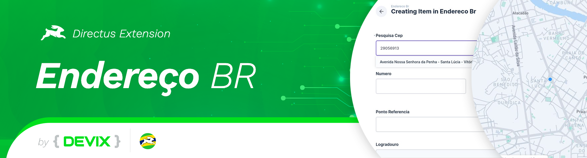
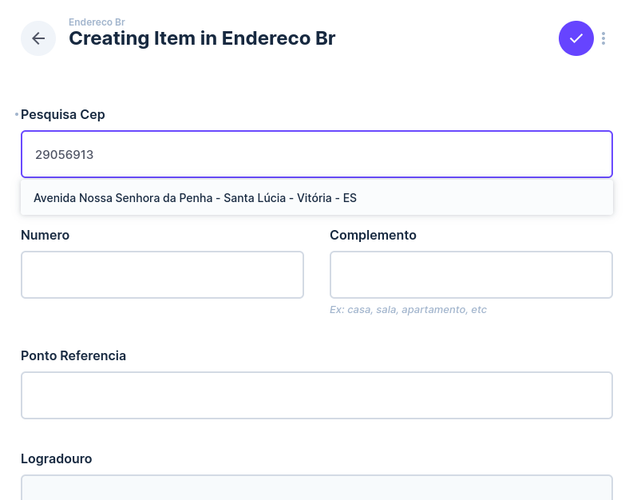
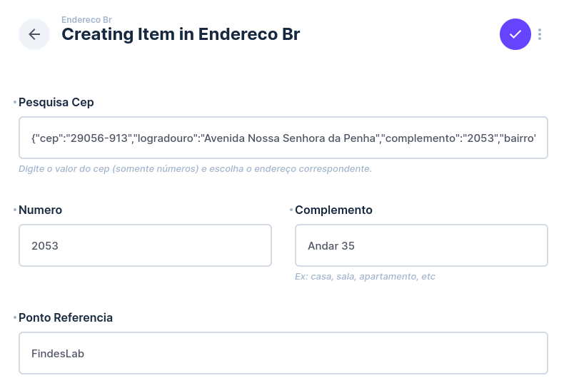
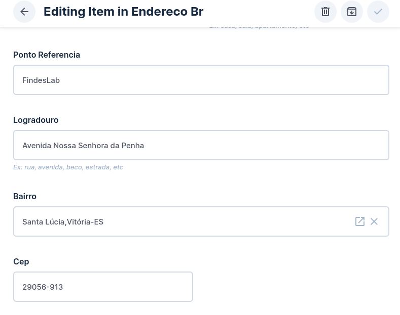
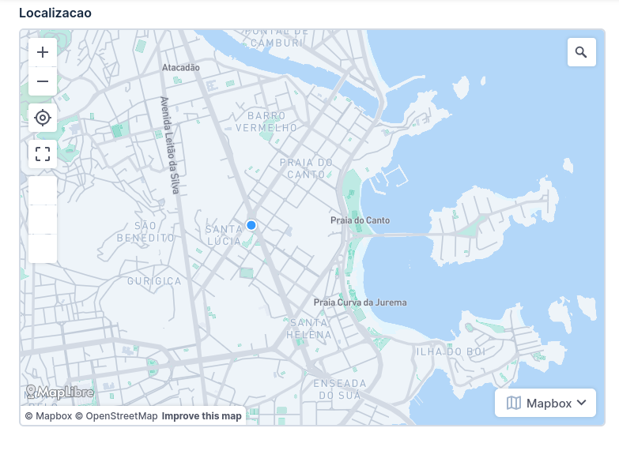
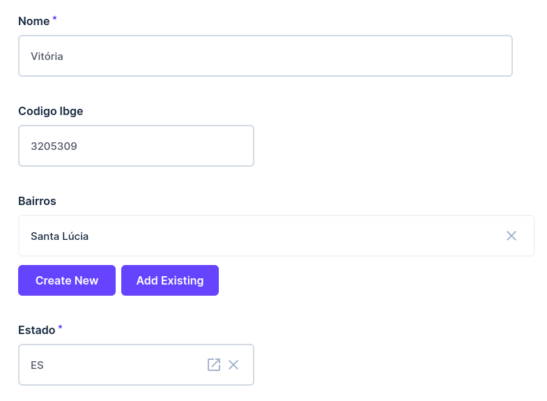

# Extensão do Directus para Endereços Brasileiros

> Crie, organize, pesquise e georreferencie endereços brasileiros de forma fácil e eficiente

[](https://www.npmjs.com/package/directus-extension-endereco-br)
[](https://github.com/devix-tecnologia/directus-extension-endereco-br/blob/main/LICENSE)
[](https://directus.io/)

## 🎯 Compatibilidade

Faixa declarada no `package.json` (`directus:extension.host`): `^10.3.4 || ^11.0.0`, ou seja, do Directus 10.3.4 até a última 11.x.

A extensão detecta automaticamente a versão do Directus e adapta seu comportamento. Você pode atualizar do Directus 10 para 11 sem precisar alterar a extensão.

### Matriz validada

Testes unitários e de integração (Docker, imagem oficial `directus/directus`, SQLite) executados com a extensão compilada:

| Directus | Situação    | Observação                                                           |
| -------- | ----------- | -------------------------------------------------------------------- |
| 11.17.4  | ✅ Validado | Última 11.x; versão padrão dos testes                                |
| 11.0.0   | ✅ Validado | Primeira 11.x                                                        |
| 10.13.4  | ✅ Validado | Última 10.x                                                          |
| 10.4.2   | ✅ Validado | Menor imagem Docker dentro da faixa (não há imagem 10.3.4 publicada) |
| 12.x     | ❌ Fora     | Não suportado: a v12 muda a licença do Directus                      |

Para repetir a validação: `pnpm build && pnpm test:all-versions` (ou `DIRECTUS_TEST_VERSION=11.17.4 pnpm test:integration` para uma versão só).

## ✨ Funcionalidades

### 🔍 Pesquisa por CEP

Agilize o cadastro de endereços permitindo pesquisar a partir do CEP para buscar automaticamente:

- Logradouro
- Bairro
- Cidade
- Estado
- Código IBGE

### ⚙️ Configuração Automática

Toda a estrutura necessária é criada instantaneamente:

- Coleções e relacionamentos são configurados durante a instalação
- Lista completa dos estados brasileiros é inserida no banco de dados
- Interface amigável pronta para uso

### 📍 Georreferenciamento

Localize endereços precisamente:

- Armazena latitude e longitude dos endereços
- Integração com os principais provedores de geolocalização
- Visualização em mapa

## 🛠️ Configuração

### Provedores de Georreferenciamento

Configure as seguintes variáveis de ambiente para habilitar o georreferenciamento:

| Variável                 | Descrição                              | Valores Aceitos          |
| ------------------------ | -------------------------------------- | ------------------------ |
| `GEOLOCATION_PROVIDER`   | Provedor de geolocalização             | `'google'` ou `'mapbox'` |
| `GEOLOCATION_AUTH_TOKEN` | Token de autenticação da API escolhida | Seu token de API         |

### Provedores Suportados

- [Google Maps Platform](https://developers.google.com/maps/) - API completa de geolocalização e visualização de mapas
- [Mapbox](https://www.mapbox.com/) - Plataforma precisa de dados de localização

## 📦 Instalação

### Via Marketplace (Recomendado)

A partir da versão 10.10 do Directus:

1. Acesse o painel administrativo do Directus
2. Navegue até `Configurações → Marketplace`
3. Pesquise por `endereco-br`
4. Clique em "Instalar"

### Via NPM

```bash
npm install directus-extension-endereco-br
```

## 🖼️ Screenshots

### Pesquisa por CEP


_Faça a pesquisa por CEP e selecione o endereço rapidamente_

### Preenchimento de Informações Adicionais


_Preencha informações adicionais para completar o cadastro_

### Preenchimento Automático


_Ao salvar, os principais campos são preenchidos com os dados da pesquisa automática_

### Georreferenciamento


_Georreferenciamento do endereço quando configurado_

### Cadastro Automático


_Cadastro automático de bairro e cidades incluindo informações do IBGE_

## 🤝 Contribuição

Contribuições são bem-vindas! Para contribuir com código, consulte o [Guia de Contribuição](CONTRIBUTING.md) com instruções detalhadas sobre desenvolvimento, testes e padrões de código.

Para reportar bugs ou sugerir funcionalidades, abra uma [issue](https://github.com/devix-tecnologia/directus-extension-endereco-br/issues).

## 📄 Licença

[MIT](https://github.com/devix-tecnologia/directus-extension-endereco-br/blob/main/LICENSE)

## 👥 Autores

- [Fernando Gatti](https://github.com/gattifernando)
- [Lucas Scart](https://github.com/scart97)
- [Rafael Paviotti](https://github.com/RPaviotti)
- [Sidarta Veloso](https://github.com/sidartaveloso)

---

<p align="center">
  Desenvolvido com ❤️ por <a href="https://github.com/devix-tecnologia">Devix Tecnologia</a>
</p>
